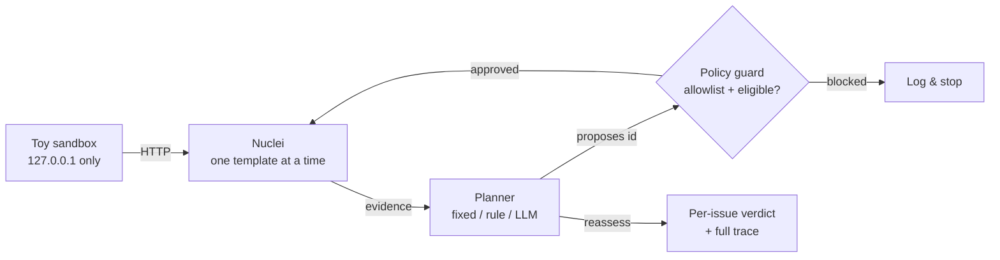

# NucleiPilot — Evidence-Guided Follow-Up for Nuclei

A lightweight, **auditable agentic layer** on top of the open-source
[Nuclei](https://github.com/projectdiscovery/nuclei) vulnerability scanner. Instead of
blindly running every template, NucleiPilot observes the evidence from a cheap discovery
pass, then an AI planner **chooses which follow-up validation to run next** — under a
fixed test budget, and inside a hard policy (localhost-only targets + an allowlist of
approved templates). Every scanner action is independently authorized and logged.

> **Testing scope — read first.** All active testing is performed **only** against a
> self-hosted synthetic sandbox on `127.0.0.1`. No real or third-party systems are
> tested. This is an authorized security-research prototype.

*Status: work in progress (Day 2 of 5 complete). This README grows as pieces land.*

---

## Why

A conventional scan runs a fixed set of templates regardless of what it finds. Two gaps:
1. **Wasted work** on targets where a signal never appeared.
2. **No prioritization** when budget is limited and several signals compete.

NucleiPilot adds two narrowly-scoped agentic capabilities:
- **Context-aware triage** — interpret each signal (an *indicator* is not a confirmed
  finding) and estimate confidence.
- **Adaptive follow-up selection** — pick the most valuable next validation given the
  evidence, the target context, and the remaining budget; then reassess.

## How it works



The loop is **observe → reason → act → reassess**. The planner only ever *proposes* a
template id; `policy.validate_choice` decides — in code — whether it runs. The model
cannot invent a template, reach a new host, or run a raw command.

## Safety model

- **Target allowlist** — `scanner.assert_in_scope` rejects anything but `127.0.0.1`/`localhost`.
- **Template allowlist** — planners may only choose from `policy.ALLOWLIST`; unknown ids are blocked.
- **Fixed command line** — the Nuclei invocation is built in code; callers can't inject flags.
- **No outbound calls** — scans run with `-ni` (no interactsh/OAST) and `-duc` (no update check).
- **Bounded budget** — a hard cap on follow-up validations per run.
- **Full trace** — every observation, decision, policy verdict, and action is recorded.

## Reproduce

**Prerequisites:** Python 3.10+, Git, [Nuclei v3](https://github.com/projectdiscovery/nuclei/releases)
(on `PATH`, or set `NUCLEIPILOT_NUCLEI_BIN`), and — only for the LLM planner — an
OpenRouter key.

```powershell
# from the repo root
py -m venv .venv
.\.venv\Scripts\python.exe -m pip install -r requirements.txt

# 1) unit tests — no Nuclei or API key needed
.\.venv\Scripts\python.exe -m unittest discover -s tests -v

# 2) sandbox smoke test — no Nuclei or API key needed
.\.venv\Scripts\python.exe scripts\smoke_sandbox.py

# 3) a real Nuclei scan of the toy app (needs Nuclei)
.\.venv\Scripts\python.exe scripts\scan_once.py --profile admin

# 4) adaptive rule vs. exhaustive fixed, all profiles (needs Nuclei)
.\.venv\Scripts\python.exe scripts\compare_rule_vs_fixed.py

# 5) LLM vs rule under a 1-follow-up budget (needs Nuclei + .env key)
copy .env.example .env   # then paste your OpenRouter key into .env
.\.venv\Scripts\python.exe scripts\llm_decision_demo.py
```

## Repo layout

```
nucleipilot/      sandbox · scanner (scope guard) · policy (allowlist) · planner (fixed/rule/llm) · workflow · llm_client
templates/        4 local demo templates (indicator + validation × admin/debug)
scripts/          runnable reproductions of every experiment
tests/            unit tests (deterministic; no Nuclei/API needed)
results/          evidence (scratch at top level; curated set in results/final/)
docs/             work_log.md + (coming) market, architecture, findings, decision
```

## Current limitations

- Synthetic toy environment with two issue classes; small sample.
- The LLM planner's eligible actions are limited to signal-driven follow-ups (by design).
- Single-run LLM results so far; repetition/metrics/failure-mode analysis is in progress.
- Not a general autonomous exploitation tool, and not production-ready.

## Coming (per assignment)

Market landscape & capability map · VulHub real-CVE generalization demo · enterprise
architecture & stakeholder map · 2-person roadmap · one-page findings · 5-slide deck ·
~5-minute demo video · build/no-build recommendation.
