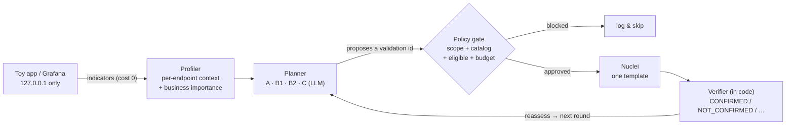

# NucleiPilot — A Governed, Evidence-Driven Agent for Nuclei

NucleiPilot is a thin **agentic layer** on top of the open-source
[Nuclei](https://github.com/projectdiscovery/nuclei) scanner. A planner (a rule, or an LLM)
only ever **proposes** which check to run next; **code** then decides — in scope, on the
approved catalog, eligible at this step, and within a fixed test budget — whether it runs.
Every weak signal is treated as a *hint*, every finding is confirmed **on evidence**, and
every observation, decision, policy verdict, and action is written to a full trace.

> **The one invariant:** *the model proposes, the code authorizes.* The planner cannot invent
> a template, reach a new host, raise the budget, or run a raw command — those paths do not exist.

> **Testing scope — read first.** All active scanning is performed **only** against a self-hosted
> synthetic toy app on `127.0.0.1` and a throwaway local Grafana container. **No real or
> third-party systems are ever scanned.** This is an authorized security-research prototype — a
> triage/follow-up layer, **not** an autonomous exploitation tool.

*Status: proof-of-concept complete and evaluated end-to-end with real Nuclei and a real LLM
(see [`results/final/`](results/final/) and [`docs/`](docs/)). Executive deck done; ~5-min demo video to record.*

---

## Why

A conventional scan runs a fixed template set regardless of what it finds, and offers no
prioritization when the budget is tight and several signals compete. NucleiPilot adds two
narrow capabilities, under hard governance:

- **Evidence-based triage** — an *indicator* (a weak signal) is not a finding; a *validation*
  confirms it by matching a content signature. A fired template that fails its validation is
  rejected as a false positive.
- **Budget-aware, business-aware follow-up** — pick the most valuable next validation given the
  evidence, the target's business context, and the remaining budget; then reassess.

## How it works



The loop is **profile → decide → authorize → scan → verify → reassess**. Verdicts are assigned
**in code**, never by the LLM, from one of five labels:
`CONFIRMED` · `NOT_CONFIRMED` · `UNVERIFIED` · `NO_INDICATOR` · `TEST_ERROR`
(a scan error is checked *before* a match, so a failed scan is never mistaken for a clean result).

**The budget.** Indicators are free (cost 0); each validation costs 1 unit; the budget is 2.
One validation runs per round, with a reserve rule (the first commit leaves room to react), so
the planner must *choose* — which is exactly what makes the comparison below meaningful.

## The experiment, in one table

The toy app serves five endpoints whose **technical severity diverges from business importance** —
the choice the whole PoC turns on:

| Endpoint | Business importance | Real issue | Severity |
|---|---|---|---|
| `/payments` | **critical** | admin console, no auth | medium |
| `/account` | **high** | PII / secret leak | medium |
| `/docs` | low | debug interface exposed | **high** |
| `/health` | low | debug flag set, **but nothing exposed** (benign trap) | — |
| `/home` | low | none | — |

Four planners compete at the same budget of 2, on the same discovered signals:

| | Planner | How it decides |
|---|---|---|
| **A** | Fixed (reference) | runs every validation — the ceiling, not a same-budget competitor |
| **B1** | Severity-only rule | orders by technical severity (the naive baseline) |
| **B2** | Context-aware rule | business importance → severity (the **strong** non-LLM bar to clear) |
| **C** | LLM | proposes from structured context + evidence + budget; code enforces every choice |

**The honest result** (computed by the harness into [`results/final/summary.md`](results/final/summary.md),
nothing hard-coded): under budget 2, **B1** chose the high-severity `/docs` debug check and
could not tell it from the `/health` trap, so it **missed** the business-critical `/payments`
and `/account`. **B2** and **C** both confirmed `/payments` + `/account`. **C ties B2 on
outcome** — the same confirmed findings on every one of 3 runs (the validation *order* varied
run-to-run, the expected LLM nondeterminism, but the outcome did not). So on this small,
fully-labeled toy the LLM shows **no prioritization advantage over a well-tuned rule** — and we
say so plainly. The durable value is the **governed, evidence-driven loop and its
generalization**, not the model out-picking a rule. See [`results/final/findings.md`](results/final/findings.md)
for the full claim-by-claim evidence, and [`docs/toy_spec.md`](docs/toy_spec.md) §7 for what this
can and cannot prove.

## Safety model

- **Scope guard** — `scanner.assert_in_scope` rejects anything but `127.0.0.1` / `localhost`.
- **Approved catalog** — planners may only choose templates in the active catalog (`config/catalog.json`); an unknown id is blocked.
- **Eligibility + budget** — a template must be eligible at this step, and the loop never exceeds the validation budget.
- **Fixed command line** — the Nuclei invocation is built in code (`-ni` no interactsh/OAST, `-duc` no update check); callers cannot inject flags or reach the network.
- **Full trace** — every observation, decision, policy verdict, and action is recorded per run under `results/final/traces/`.

All four failure modes are demonstrated failing safe (an out-of-scope target, an invented
template id, malformed model output, an over-budget request) in
[`results/final/safety_checks.md`](results/final/safety_checks.md).

## Reproduce — every result, from the repo root

**Prerequisites:** Python 3.10+ · [Nuclei v3](https://github.com/projectdiscovery/nuclei/releases)
(on `PATH`, or set `NUCLEIPILOT_NUCLEI_BIN` to its full path) · an OpenRouter API key **only** for
the LLM planner (method C and the Grafana demo) · Docker **only** for the Grafana demo.

**The five steps, and what each needs** (output always lands in `results/final/`):

1. **Unit tests** (37, deterministic) — *Python only*
2. **Toy-app smoke test** — *Python only*
3. **Full A/B1/B2/C experiment** — E1 comparison + E2 context-flip + E3 trap; starts the toy itself; needs *Nuclei* (+ the *LLM key* for method C)
4. **Safety / fail-safe demonstrations** (E5) — *Python only*
5. **Real-app generalization** — E4/E6 on a local *Grafana 8.3.0*; starts the container itself; needs *Docker + Nuclei + the LLM key*

Run the block for your OS from the repo root. Steps 3 (method C) and 5 read your OpenRouter key
from `.env`; without it, A/B1/B2 and every deterministic step still run, and C's recorded evidence
is already in `results/final/`.

**Windows (PowerShell):**
```powershell
py -m venv .venv
.\.venv\Scripts\python.exe -m pip install -r requirements.txt
$env:NUCLEIPILOT_NUCLEI_BIN = "C:\path\to\nuclei.exe"   # only if Nuclei isn't on PATH
copy .env.example .env                                   # then paste your OpenRouter key (steps 3C & 5)

.\.venv\Scripts\python.exe -m unittest discover -s tests   # 1
.\.venv\Scripts\python.exe scripts\smoke_toyapp.py         # 2
.\.venv\Scripts\python.exe scripts\run_experiment.py       # 3
.\.venv\Scripts\python.exe scripts\safety_checks.py        # 4
.\.venv\Scripts\python.exe scripts\run_grafana.py          # 5  (stop after: docker rm -f np-grafana)
```

**macOS / Linux (bash):**
```bash
python3 -m venv .venv
./.venv/bin/python -m pip install -r requirements.txt
export NUCLEIPILOT_NUCLEI_BIN=/path/to/nuclei            # only if Nuclei isn't on PATH
cp .env.example .env                                     # then paste your OpenRouter key (steps 3C & 5)

./.venv/bin/python -m unittest discover -s tests          # 1
./.venv/bin/python scripts/smoke_toyapp.py                # 2
./.venv/bin/python scripts/run_experiment.py              # 3
./.venv/bin/python scripts/safety_checks.py               # 4
./.venv/bin/python scripts/run_grafana.py                 # 5  (stop after: docker rm -f np-grafana)
```

**Where output lands.** Everything writes to [`results/final/`](results/final/):
`comparison.csv`, `summary.md` (E1–E3, generated from the runs), `findings.md` (the claims page),
`e3_trap.json`, `safety_checks.md` (E5), `grafana_demo.json` (E4), `e6_generalization_note.md` (E6),
and a per-run `traces/`. Inspect any trace with `scripts\show_trace.py`.

## Generalization — a real CVE on a real app (Grafana)

The **same engine** runs against an app we did not write — Grafana is just another entry in the
asset registry + catalog. Against a local **Grafana 8.3.0** container, the agent fingerprints the
version via `/api/health`, then — given two candidate CVEs and a budget of 1 — reasons from the
detected version to pick the **applicable** `CVE-2021-43798` (affects 8.0.0–8.3.0) over an
inapplicable distractor `CVE-2020-13379` (3.0.1–7.0.1), with **zero CVE-specific decision code**.
It then confirms the arbitrary-file read **read-only**: first a harmless planted marker file
(`/tmp/np-marker.txt` → `CONFIRMED`), then `/etc/passwd` as a secondary proof (`CONFIRMED`).
Evidence: [`results/final/grafana_demo.json`](results/final/grafana_demo.json). The finding is
corroborated independently with ProjectDiscovery's **official** community template
([`results/final/vulhub_grafana_demo.json`](results/final/vulhub_grafana_demo.json), reproducible
with `scripts\vulhub_demo.py` after `nuclei -update-templates`).

## Repo layout

```
nucleipilot/   toyapp · registry · profiler · policy (catalog + gate) · scanner (scope guard) ·
               planners (A/B1/B2/C) · engine (the loop) · verifier · llm_client
config/        asset_registry.json · catalog.json · grafana_catalog.json · toy_answer_key.json
templates/     7 toy-*.yaml (indicator + validation per issue) · 3 grafana-cve-*.yaml
scripts/       smoke_toyapp · run_experiment · safety_checks · run_grafana · show_trace ·
               vulhub_demo (optional official-template corroboration)
tests/         37 deterministic unit tests (no Nuclei / no API)
results/final/ comparison.csv · summary.md · findings.md · e3_trap.json · safety_checks.md ·
               grafana_demo.json · e6_generalization_note.md · traces/ · vulhub_grafana_demo.json
docs/          poc_plan · toy_spec · implementation_roadmap · landscape_and_capability_map ·
               enterprise_architecture · two_person_roadmap · build_decision · work_log
presentation/  AXP_Executive_Deck.pptx
```

## Current limitations (stated plainly)

- A controlled, fully-labeled toy (5 endpoints) plus one real-CVE scenario — **not** a broad
  real-world benchmark.
- On this small toy the LLM (C) **ties** the well-tuned context-aware rule (B2); it does not beat
  it. The value here is governance, evidence discipline, and generalization — not out-picking a
  rule. Whether LLM reasoning beats a rule on messy, unlabeled real targets is exactly what the
  90-day pilot in [`docs/build_decision.md`](docs/build_decision.md) is designed to measure.
- The LLM's pick *order* is nondeterministic run-to-run (same confirmed set, different sequence);
  under the budget this does not change the outcome, and the harness reports it rather than hiding it.
- Single model (`gpt-4o-mini`) tested; a multi-model reliability comparison is future work.
- The agent helps *choose and triage* — Nuclei already does the detecting. It is not a replacement
  for human pentesters or for the scanner, and is not production-ready.

## Assignment deliverables

- **Part 1 — Landscape & capability map:** [docs/landscape_and_capability_map.md](docs/landscape_and_capability_map.md)
- **Part 2 — The PoC:** this repo · [the 2-day plan](docs/poc_plan.md) · [toy design & honesty note](docs/toy_spec.md) · [build roadmap](docs/implementation_roadmap.md) · evidence in [results/final/](results/final/) (start with [findings.md](results/final/findings.md))
- **Part 3 — Enterprise architecture & stakeholder map:** [docs/enterprise_architecture.md](docs/enterprise_architecture.md)
- **Part 4 — 2-person, 90-day roadmap:** [docs/two_person_roadmap.md](docs/two_person_roadmap.md)
- **Part 5 — Build / no-build decision:** [docs/build_decision.md](docs/build_decision.md)
- **Executive deck (5 slides):** [presentation/AXP_Executive_Deck.pptx](presentation/AXP_Executive_Deck.pptx)
- **In progress:** ~5-minute demo video.
