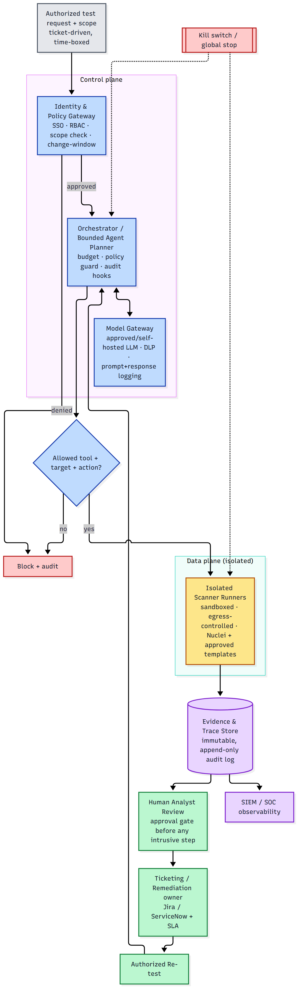

# Enterprise Architecture & Stakeholder Map

*AMEX / Atos take-home, Part 3. How a transparent, policy-constrained agentic follow-up
layer (NucleiPilot) would sit inside a large bank's security function — and the people you'd
need to get through first.*

---

## 1. Production architecture

The PoC already contains the seeds of the production controls: a **scope guard** (→ the
identity/policy gateway), a **template allowlist + policy check** (→ the policy engine), a
**bounded budget** (→ orchestration limits), and a **full decision trace** (→ the evidence/
audit store). Production hardens and scales these; it does **not** change the trust model.

Blue = control plane · amber = isolated data plane · green = human review &amp; remediation · purple = evidence store &amp; observability · red = stop/deny. Diagram source: [`figures/production_architecture.mmd`](figures/production_architecture.mmd).

### Components
- **Request intake** — every run starts from a ticket with an explicit, time-boxed scope. No standing "scan anything" authority.
- **Identity & Policy Gateway** — SSO + role-based access; validates the target against an **approved-asset registry**; enforces change windows. (Production form of the PoC's `assert_in_scope`.)
- **Orchestrator / Bounded Planner** — the agent loop with a **hard budget**, the **policy guard**, and audit hooks on every decision. (Production form of the PoC's `engine.py` + `policy.py`.)
- **Model Gateway** — routes to an **approved or self-hosted** LLM; applies **data-loss-prevention** so only sanitized/synthetic signals reach the model; logs every prompt/response. (Governs what the PoC's `llm_client.py` sends.)
- **Isolated Scanner Runners** — sandboxed, egress-controlled workers that run Nuclei against **in-scope targets only**. Non-production first.
- **Evidence & Trace Store** — immutable, append-only record of every observation, decision, policy verdict, and action. (Production form of the PoC's JSON traces.)
- **Human Analyst Review** — a required approval gate before any intrusive step; confirmed findings only flow onward.
- **Ticketing / Re-test** — findings become owned tickets with SLAs; fixes are re-tested under authorization.
- **SIEM / SOC + Kill switch** — all activity is observable to the SOC, and a global stop can halt the planner and runners instantly.

### Key safeguards (what you bring to the table)
Approved-asset **target allowlist** · **template allowlist** · **RBAC** · **non-production-first** · **isolated, egress-controlled runners** · **secrets vault + least privilege** · **rate limits & timeouts** · **immutable audit trail** · **human approval before intrusive actions** · **stop/kill switch** · **LLM data governance** (sanitized input, prefer self-hosted) · **change-management windows** · **privacy/compliance sign-off**.

---

## 2. Stakeholder map

The order below is the rough sequence you'd actually need to clear.

| Stakeholder | What they care about | First objection you'd hear | Your response / what you bring |
|---|---|---|---|
| **NetSec / Security Operations (SOC)** | Signal quality; alert fatigue | *"This will flood us with unvalidated findings."* | Evidence-based validation (every finding has a trace); analyst-review gate; our measured **0 false positives in controlled tests** + fixed/rule/LLM benchmark |
| **Network / Infra Ops** | Uptime; scanner load | *"Your scans will degrade or break production."* | Rate limits, bounded budget, scope allowlist, scheduling/change windows, **staging-first**, no outbound OAST (`-ni`) |
| **Infrastructure / Security Architecture** | Blast radius; where it runs; secret access | *"What can this reach, and where do its credentials live?"* | Isolated egress-controlled runners, least-privilege, secrets vault, network segmentation, immutable audit |
| **Compliance / Legal / Privacy** | Authority to test; data handling (esp. LLM egress) | *"Are we authorized to test this, and does sending data to an LLM violate policy?"* | Written authorization workflow + approved-asset registry; **DLP so only sanitized data reaches the model** (prefer self-hosted); retention controls; full audit trail |
| **Application owners** | Service stability; who owns the fix | *"Will this break my service, and who remediates what you find?"* | Staging by default, safe template set, change windows, clear finding ownership + remediation SLAs |
| **Procurement / Vendor Risk** | Cost vs benefit; build-vs-buy; lock-in | *"Why build this instead of buying XBOW/Pentera, and is the LLM cost justified?"* | Measured comparison vs free/simple baselines (our evidence); transparency + governance edge for regulated use; **open-source foundation = no lock-in**; the honest "rules + LLM-for-triage" scoping |
| **CISO / leadership** | Net risk; measurable value; accountability | *"Does the autonomy create more risk than it's worth?"* | Bounded autonomy + human-in-loop + kill switch; a **controlled pilot** with explicit success metrics and a stop criterion |

---

## 3. The one-line pitch per room
- **To SecOps:** *"Fewer, evidence-backed findings — each one comes with the exploit trace, not a maybe."*
- **To Infra/Architecture:** *"It can only touch an approved-asset allowlist from isolated workers, and every action is logged and killable."*
- **To Compliance:** *"Testing is ticket-authorized and scoped; only sanitized signals reach the model, ideally self-hosted."*
- **To Procurement:** *"Open-source core, measured against non-AI baselines — we add the LLM only where it demonstrably helps."*

The through-line: **transparency, governance, and evidence** — the same niche the landscape scan identified as unclaimed, and the one a bank values most.
