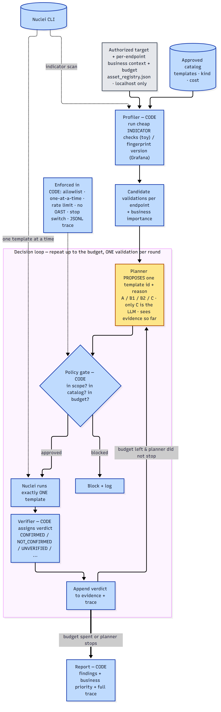

# NucleiPilot — Plan (2-Day POC)

*A small, honest offensive-security proof of concept. Two local targets. An LLM agent that makes
a few decisions around the Nuclei scanner, with code in control of everything that runs.*

---

## 1. Why build an agent around Nuclei?

Nuclei is already good at scanning. It runs template-based security checks, it can detect the
technology on a site and pick matching templates on its own (`-automatic-scan`), it has tags,
filters, and JSON output. **We are not replacing the scanner, and we are not saying these features
are missing.**

What we add is small and specific: we automate a few decisions that a human analyst normally makes
*around* a scan.

| Decision | What usually happens | What our agent adds |
|---|---|---|
| **Which checks to run?** | A person picks settings, or relies on generic filtering. | The agent proposes a short, ordered list of approved template IDs, using the detected technology **and a budget**. |
| **What to check next?** | A person sees a first signal and decides what to verify. | The agent proposes **one** safe follow-up check when the evidence is not yet clear. |
| **What matters most?** | Nuclei gives a technical severity and the matching evidence. | The agent adds the asset's **business context**, so confidence and business priority are explained separately from technical severity. |

**Be honest about the limit:** the agent helps with *choosing checks and triaging results*. It does
**not** make Nuclei detect better. Detection is already Nuclei's strength.

**But do not undersell it, either.** The durable value is **governance** (a flexible proposer driving a
real scanner while code authorizes every action) and **generalization** (extending to new targets and
new CVEs without hand-writing a rule for each). Smart prioritization sits on top; on a small toy a tuned
rule can match that one capability, so we test it honestly rather than overclaim (see `toy_spec.md`
§6–§7).

---

## 2. What we are testing (the hypothesis)

> A thin agent can pick useful checks and a useful follow-up, run **fewer wasted checks**, and keep
> coverage and safety **as good as** a normal Nuclei scan. We will **measure** this, not assume it.

One clarification that shapes the whole experiment: the clearest win we expect is **smart
prioritization under a tight budget** — that is, *which single check is worth spending the budget on*
— not simply "runs fewer checks." On a small template set, the "fewer checks" difference is tiny, so
we treat it as secondary and put prioritization first.

---

## 3. What we will demonstrate (two local targets)

**Target 1 — our toy website.** A small app we built on `127.0.0.1`, with findings we planted on
purpose and a **known answer key**. This is our main test of correctness, because we know exactly
what is there.

**Target 2 — local Grafana 8.3.0.** A real piece of software, pinned to an old version, run in an
isolated local container. It shows the **same agent flow works on software we did not write** — and, in
the final build (experiment **E3**), that the agent can **curate the right check from the real ~14k
ProjectDiscovery template corpus**, not just a hand-made catalog.
- **Non-destructive checks only.** "Non-destructive" means the check **reads only** — no writes, no
  changes to the app's state, no denial of service. A **read-only safety allowlist** enforces this: an
  intrusive CVE (several Grafana CVEs are DoS / state-changing) is refused by the policy gate even if the
  model proposes it.
- **Real community template.** The arbitrary-file-read (`CVE-2021-43798`) is confirmed with the
  **official ProjectDiscovery community template** taken from the corpus — it reads `/etc/passwd`, which
  is harmless on our throwaway local container — not with a hand-written one.
- **Local only.** No public network. We report only what we can actually show — no vulnerability
  claims we cannot back with evidence.

---

## 4. Proposed architecture

**One controlled agent loop.** One LLM, one Nuclei CLI, one code-based policy gate, and at most one
follow-up round.

> **The rule that never changes: the model proposes; code authorizes.**
> A template match is not automatically a confirmed vulnerability. And no match does **not** prove an
> app is clean.

Amber = the single LLM-driven step (the planner) · blue = enforced in code. Diagram source: [`figures/poc_flow.mmd`](figures/poc_flow.mmd).

### What each part does (in plain terms)

- **Asset registry** — the list of targets we are *allowed* to scan. Each entry has the URL, the
  **business context (which can be set per endpoint/component, not just per site)**, and the budget.
  The toy app is the registry entry; the scope check reads this list and is enforced in code. (The
  Grafana experiment, E3, builds its candidate catalog from the real nuclei-templates corpus rather than
  this registry — see `scripts/run_grafana.py`.) A future authorized site is just **one more entry (or
  one more corpus filter)**.
- **Context profiler (Python)** — reads the allowed target and collects simple technology facts
  (what software, what version). The business context and the budget come from configuration. This
  step uses **no LLM**, which keeps the attack surface small.
- **Approved catalog** — the only templates the agent may ever choose from. Each template is labelled
  with its technology, its kind (**indicator** = weak hint, or **validation** = stronger confirmation),
  its severity, and its cost. Growing coverage later means adding templates, not changing code.
- **Budget** — a simple limit on the **validation runs** (the expensive confirmations) the agent may
  spend on a target. Indicators are cheap discovery and cost **0 budget units** (though they still take
  real requests and time). This is what forces the agent to choose instead of confirming everything.
  **One slot is held back for the follow-up**, so the first plan may use at most `budget − 1` —
  otherwise the first round could eat the whole budget and leave nothing to verify with. (Details:
  `toy_spec.md` §5.)
- **LLM planner (proposes)** — given the technology facts, the budget, and the allowed templates, it
  returns **JSON** with template IDs and a short reason for each. It never writes a shell command.
- **Policy gate (code decides)** — before anything runs, Python checks each proposed template: is the
  target in scope? is the template on the allowlist? is it within budget? Anything else is blocked and
  logged. The LLM cannot reach a new target, run an unapproved template, or go over budget.
- **Scanner runner (Nuclei)** — runs one approved template at a time, with a fixed command line (no
  flag injection), no outbound callbacks (`-ni`), rate limits, and JSON output saved to disk.
- **Evidence parser (code)** — turns each Nuclei result into a structured verdict and appends it to the
  running evidence. There is **no separate LLM "review" step**: the loop simply calls the **same planner
  again** with this updated evidence, and for planner C that is how the LLM makes an **evidence-aware
  follow-up** choice. That follow-up goes through the same policy gate.
- **Evidence verifier + report (code decides)** — code sets the status. A finding is **CONFIRMED**
  only when the validation finds the **specific evidence for that finding** (for example, real file
  contents in the response, or the exact "authentication: not-required" signal) — **not** just because
  a template "fired." Otherwise it is **NOT_CONFIRMED** (validation ran, evidence absent),
  **UNVERIFIED** (indicator fired, no validation run), **NO_INDICATOR** (nothing fired — not a claim the
  target is secure), or **TEST_ERROR** (a check failed — never counted as a negative). The LLM only
  **explains** relevance and business priority; it never assigns these labels. The report keeps Nuclei's
  original severity and is honest about uncertainty. (Full definitions: `toy_spec.md` §9.)
- **Trace + stop switch** — every step (profile, proposal, gate decision, scan, verdict) is written to
  a log, and a stop switch can halt the run at once.

---

## 5. How the workflow behaves (step by step)

1. **Profile** — Python reads the allowed target and gathers technology facts. Budget and business
   context come from configuration.
2. **Plan** — the LLM returns JSON with only catalog template IDs plus a short reason.
3. **Execute** — Python checks scope, allowlist, budget, and safety flags, then runs the real Nuclei
   scan and saves the JSON results.
4. **Review once** — the LLM may ask for one approved follow-up check. It passes through the same gate.
5. **Report** — code sets the status from the evidence. The LLM explains why it matters and in what
   order. Nuclei's own severity and any uncertainty are kept in the report.

---

## 6. The experiment (a fair comparison)

We compare **four** methods on the **same targets, catalog, discovery matches, and budget.** Beating a
weak baseline proves nothing, so we include a **strong non-LLM baseline (B2)**.

| A · Fixed Nuclei | B1 · Severity rules | B2 · Context-aware rules | C · NucleiPilot (LLM) |
|---|---|---|---|
| Run the full approved set. (Full-coverage, full-cost reference.) | Order by technical severity. (Conventional baseline.) | Order by business importance, then severity. (**The real bar to clear** — a few lines of Python.) | Propose from context **and** budget, then one evidence-driven follow-up. |

**Budget (defined once):** validation runs per target, **with one slot held in reserve for the
follow-up** (so the first plan uses at most `budget − 1`). B1, B2, and C run under the **same** budget;
the honest head-to-head is **C vs the stronger B2**. A runs everything with no budget — a reference for
"best coverage" and "highest cost," not a fair-budget competitor.

> **Honesty note:** this toy is small and fully labeled, so a good decision the LLM makes, B2 can also
> encode. The toy therefore **cannot prove the LLM beats a well-tuned rule** — that question is the
> 90-day pilot's job (the Part 4 decision brief). If C only ties B2, we report that; the POC still
> demonstrates a bounded, auditable, evidence-driven agent. (Details: `toy_spec.md` §6–§7.)

**What we measure:**
- **Coverage** — how many of the planted toy issues each method finds (did C miss anything A caught?).
- **Work done** — number of templates run, and time/requests where available.
- **Right follow-up** — did the agent pick a sensible next check?
- **Right priority** — under a tight budget, did C spend it on the **business-critical** issue?
- **Safety** — were unsafe or out-of-scope proposals blocked?

**Two rules that make the result trustworthy:**
- **Run each LLM decision at least 3 times** (settings fixed), and include one **context-flip** case:
  change which asset is "business-critical" and show the agent's choice flips with it. This proves the
  agent is reacting to context, not just favouring one issue.
- **Grafana:** report what we actually observe. We do **not** assume a full answer key for it.

---

## 7. Key design requirement for the toy (do this first)

This is the single most important design choice, so it is called out on its own.

The toy is **one app with several endpoints (components)**, and **business importance is set per
endpoint, not for the whole app** — because one real app often mixes, say, a payments function and a
documentation function.

**The toy must include at least one case where the most *business-critical* endpoint does NOT carry the
highest *technical severity*** — for example, a `/payments` component marked *business-critical* but
with a **medium**-severity issue, next to a `/docs` component marked *low value* but with a
**high**-severity issue. The **budget must also be tight** (smaller than "run everything").

Why this matters: if the business-critical issue is always also the highest severity, then the rules
(B) and the AI (C) will always pick the same thing, and we learn nothing. Per-endpoint importance plus
this divergence is what lets the experiment actually test the hypothesis.

---

## 8. Two-day build checklist

Several core pieces already exist in the repo (policy guard, scanner wrapper, results parser), so we
**reuse and extend** them rather than rewrite.

**Day 1 — make the scanner and guard real**
1. Start the toy app and the isolated Grafana 8.3.0; record versions and ports.
2. Curate about **6–10 safe templates**, each labelled indicator/validation, with severity and cost,
   including the divergence case from Section 7. Each **validation** template must match on **specific,
   finding-relevant evidence** (a content signature), not just a status code.
3. Run real Nuclei and save JSON results, timings, and the baselines.
4. Build/extend the asset registry, the approved catalog, the policy gate, the scanner wrapper, and
   the parser.

**Day 2 — make the AI decisions real**
1. Connect the LLM so it returns structured JSON IDs; reject any invalid proposal.
2. Add the one optional follow-up and the evidence-based status.
3. Run A / B / C with equal budgets; save traces and metrics, **including failures**; add the repeat
   runs and the context-flip case.
4. Finish the README, a short results note, the architecture figure, and the 5-minute demo.

---

## 9. Safety checks we will show failing safe

We will test and log each of these being handled correctly:
- an **out-of-scope target** → blocked;
- a **template not on the allowlist** → blocked;
- a **malformed JSON** answer from the LLM → rejected, run stops safely;
- a proposal that would go **over budget** → blocked.

---

## 10. What the reviewer gets, and the pass condition

**A runnable repository:** agent, policy, and scanner code; config for the target and template
allowlists; the local target setup; the curated templates; tests; results (raw JSON plus a comparison
table); docs; a README; and a demo link.

**A five-minute demo:** run against the toy site, show the Nuclei evidence, show the agent choosing a
follow-up, show an out-of-scope proposal being blocked, show the final report, and briefly show
Grafana running in isolation.

> **Pass condition:** real scans on both local targets, at least one meaningful AI-driven decision, a
> safely controlled follow-up, a full evidence trace, and an honest comparison against the non-AI
> baselines.

*(The wider AMEX package — market scan, stakeholder/deployment view, two-person roadmap, build/no-build
recommendation, and the executive deck — is kept in separate documents.)*
